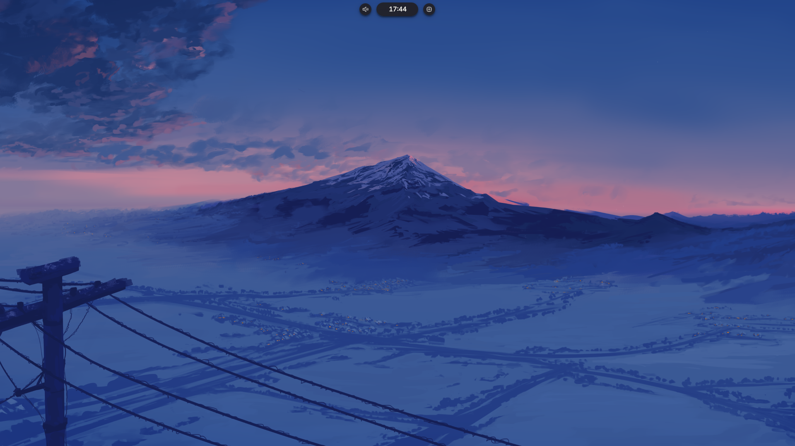
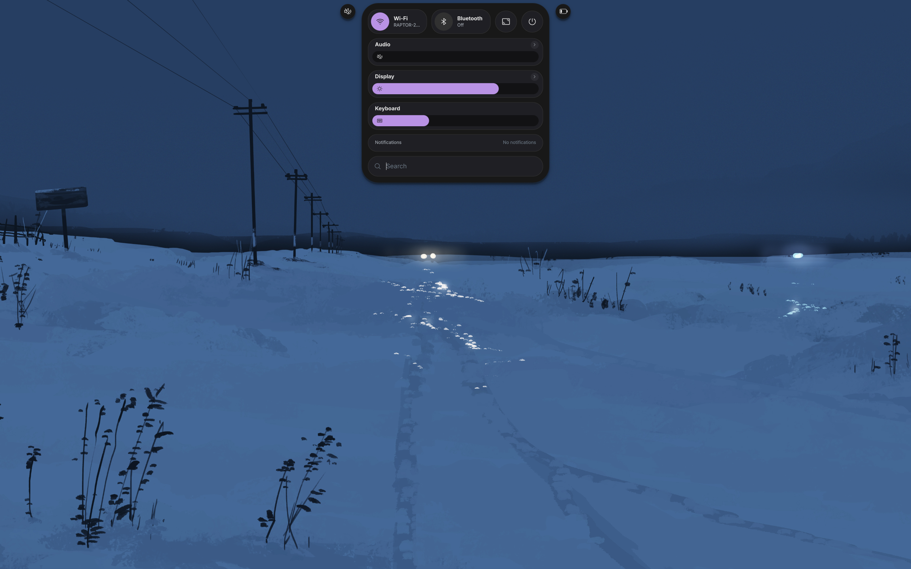
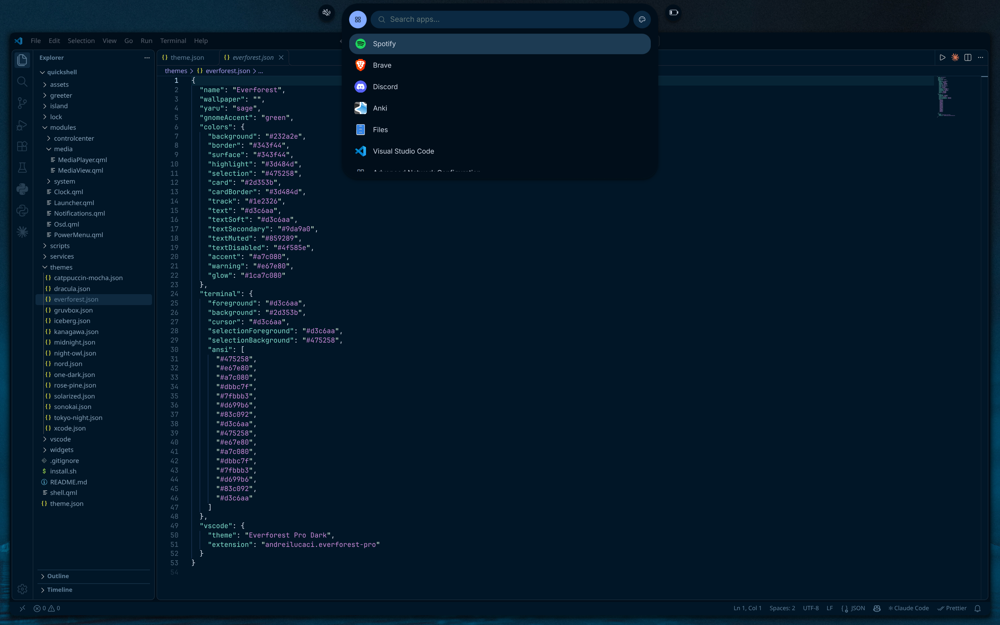
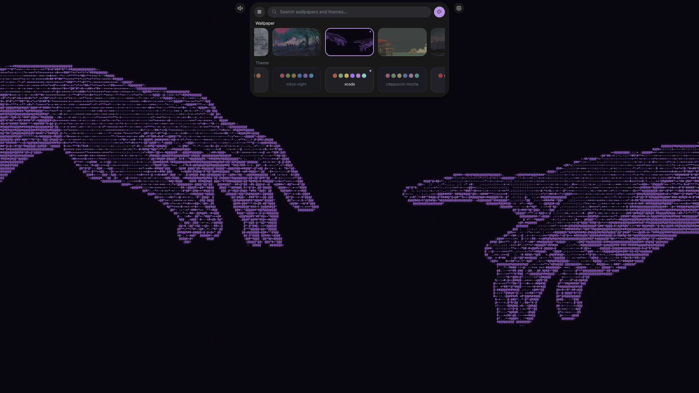
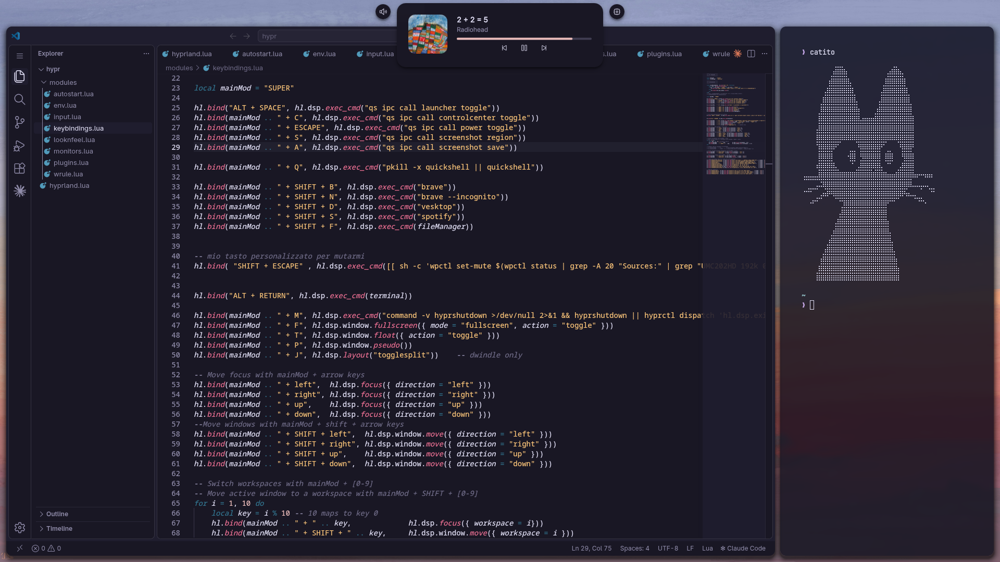
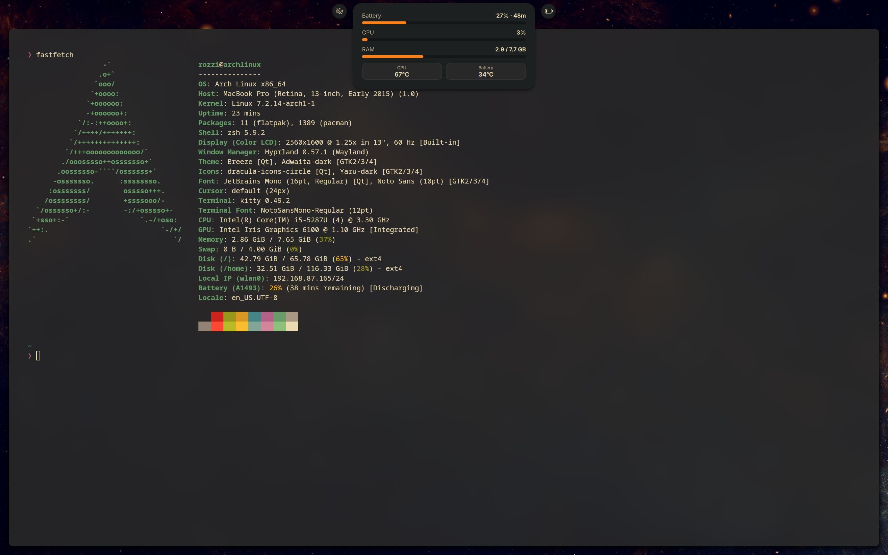

# Quickshell island

A Hyprland shell built on Quickshell (>= 0.3): an island at the top of the
screen with clock, notifications, launcher, media player, control center,
lock screen and login screen. Works on **Arch** and **Fedora**.

## Screenshots

<table>
  <tr>
    <td></td>
    <td></td>
    <td></td>
    <td></td>
    <td></td>
    <td></td>
  </tr>
  <tr>
    <td align="center"><b>Island</b></td>
    <td align="center"><b>Control center</b></td>
    <td align="center"><b>App launcher</b></td>
    <td align="center"><b>Theme and wallpaper switcher</b></td>
    <td align="center"><b>Media player</b></td>
    <td align="center"><b>Performance monitoring</b></td>
  </tr>
</table>

## Installation

```sh
[ -d ~/.config/quickshell ] && mv ~/.config/quickshell ~/.config/quickshell_backup
git clone https://github.com/RozziLando/quickshell.git ~/.config/quickshell
cd ~/.config/quickshell
chmod +x install.sh
./install.sh
```

Run it as your normal user: it asks for the sudo password when needed.
`install.sh` does only three things:

1. detects Arch or Fedora and installs the [dependencies](#dependencies).
   Packages that are already installed are skipped (`pacman --needed` on
   Arch; on Fedora it also enables the Hyprland and Quickshell COPRs);
2. turns on `FastConnectable` in `/etc/bluetooth/main.conf`, so known
   Bluetooth devices reconnect faster when they are switched on (the old
   file is kept as `main.conf.bak-quickshell`; applied at the next boot);
3. if VS Code, VSCodium or Code - OSS is installed, asks whether to install
   the local extension that makes it follow the shell theme (see
   [VS Code themes](#vs-code-themes)).

Everything else is up to you: put (or link) the folder in
`~/.config/quickshell`, set your options in [`theme.json`](#themejson), add
the [keybinds](#keybinds) you want to the Hyprland config and start the shell
with Hyprland (`exec-once = quickshell`, or `hl.exec_cmd("quickshell")` in a
Lua config).

**Login screen.** `sudo greeter/install.sh` sets it up completely, on Arch
and Fedora: it installs `greetd` and `cage`, copies the login screen to
`/etc/greetd/quickshell`, writes `/etc/greetd/config.toml` (the old one is
kept as `config.toml.bak-<date>`), disables the current display manager
(sddm, gdm, lightdm, ly...) and enables greetd. Reboot and the login screen
is there. `--dry-run` shows what it would do without changing anything; at
the end it prints the command to go back to the previous display manager.

**Profile picture.** To show your photo on the lock screen and the login
screen, put it in `assets/` named `avatar.png`, `avatar.jpg` or
`avatar.jpeg` (a square image looks best). Without it the circle shows the
first letter of your user name. The file is ignored by git, so copy it by
hand on each PC.

| Option | Effect |
|---|---|
| `./install.sh -y` | accept the defaults, ask nothing |
| `./install.sh --no-packages` | skip the package installation |

## Dependencies

| Used for | Arch | Fedora |
|---|---|---|
| Shell (>= 0.3) | `quickshell` | `quickshell` (COPR `errornointernet/quickshell`) |
| Compositor | `hyprland` | `hyprland` (COPR `solopasha/hyprland`) |
| Wallpaper | `awww` | `swaybg` |
| Wi-Fi | `networkmanager` | `NetworkManager` |
| Bluetooth | `bluez` `bluez-utils` | `bluez` |
| Audio | `pipewire` `pipewire-pulse` `wireplumber` `libpulse` | `pipewire` `pipewire-pulseaudio` `wireplumber` `pulseaudio-utils` |
| Brightness, battery | `brightnessctl` `upower` | `brightnessctl` `upower` |
| Media keys | `playerctl` | `playerctl` |
| Screenshots, lock screen | `grim` `slurp` `wl-clipboard` | `grim` `slurp` `wl-clipboard` |
| Notifications, logind signals | `libnotify` `glib2` | `libnotify` `glib2` |
| Login screen copy | `diffutils` | `diffutils` |
| .webp wallpapers | `qt6-imageformats` | `qt6-qtimageformats` |
| Fonts | `inter-font` `noto-fonts-emoji` `noto-fonts-cjk` | `rsms-inter-fonts` `google-noto-color-emoji-fonts` `google-noto-sans-cjk-fonts` |
| Login screen (installed by `greeter/install.sh`) | `greetd` `cage` | `greetd` `cage` |

`install.sh` installs all of them. The icon font (Phosphor) ships with the
shell in `assets/fonts/`.

## IPC

`qs ipc call <target> <function>` controls the running shell from a
terminal, a script or a keybind. `qs ipc show` lists everything available.

| Command | What it does |
|---|---|
| `qs ipc call launcher toggle` | open / close the app launcher |
| `qs ipc call controlcenter toggle` | open / close the control center |
| `qs ipc call power toggle` | open / close the power menu |
| `qs ipc call screenshot region` | screenshot of an area selected with the mouse, to the clipboard |
| `qs ipc call screenshot screen` | screenshot of the screen under the mouse, to the clipboard |
| `qs ipc call screenshot save` | screenshot of the screen under the mouse, to the clipboard and saved in `~/Pictures` |
| `qs ipc call media peek` | show the media player for a few seconds |
| `qs ipc call theme list` | list the themes |
| `qs ipc call theme current` | print the active theme |
| `qs ipc call theme set <id>` | apply a theme (shell, kitty, Nautilus, wallpaper), e.g. `theme set nord` |
| `qs ipc call lock lock` | lock the screen (with `"lockScreen": true`) |
| `qs ipc call lock suspend` | lock and suspend |

## Keybinds

Suggested binds for the Hyprland config (add them yourself):

| Keys | Command |
|---|---|
| `ALT + SPACE` | `qs ipc call launcher toggle` |
| `SUPER + C` | `qs ipc call controlcenter toggle` |
| `SUPER + ESCAPE` | `qs ipc call power toggle` |
| `SUPER + S` | `qs ipc call screenshot region` |
| `SUPER + A` | `qs ipc call screenshot save` |
| `SUPER + Q` | `pkill -x quickshell \|\| quickshell` (restart the shell) |
| Play / Pause / Next / Previous | `playerctl …; qs ipc call media peek` |
| Volume up / down / mute, mic mute | `wpctl …` (the island shows the volume bar by itself) |
| Screen brightness (laptops) | `brightnessctl …` (the island shows the bar by itself) |
| Keyboard backlight (if present) | `brightnessctl -d <device> …` |

Other useful commands:

| Command | What it does |
|---|---|
| `qs` / `quickshell -d` | start the shell (`-d`: detached from the terminal) |
| `pkill -x quickshell` | stop the shell |
| `qs log` | log of the running shell (`qs log -f` follows it) |
| `qs list` | running instances (there should be one) |

Saved `.qml` files and `theme.json` are reloaded automatically: there is no
need to restart the shell.

## VS Code themes

Optional: when the shell theme changes, VS Code switches to the matching
color theme, live. Everything is in one local extension,
`vscode/quickshell-theme-sync`, with nothing to download: `install.sh` asks
for it, and `scripts/vscode.sh` installs or updates it later.

- `themes/`: the VS Code theme of every shell theme, as written files.
  Catppuccin Mocha, Dracula, Everforest, Gruvbox, Iceberg, Kanagawa, Night
  Owl, Nord, One Dark, Rosé Pine, Solarized, Sonokai and Tokyo Night are
  exact copies of their official VS Code themes (licenses and versions in
  `THIRD_PARTY_NOTICES.md`); Midnight, Cloudy Quasar and Xcode are made for
  the shell. In VS Code they are called `<name> (Quickshell)`, e.g.
  `Dracula (Quickshell)`.
- `Quickshell Custom`: for a shell theme without a file in `themes/` (a
  theme you made) or whose file cannot be read, the extension generates a
  theme from the shell colors and applies it. The command
  *Quickshell: Generate Theme From Shell Colors* does the same for the
  current theme on request. When a generated theme replaces another
  generated one, VS Code asks to reload the window.

The extension acts only when the shell theme changes, so a theme picked by
hand in VS Code stays until the next one. `"vscodeThemeSync": false` in
`theme.json` turns it off. The shell never depends on the editor.

It works the same in every editor built on VS Code.

**Installing by hand.** The ready package is
`vscode/quickshell-theme-sync/local.quickshell-theme-sync-<version>.vsix`,
rebuilt by every run of the script (`scripts/vscode.sh --pack` only
rebuilds it). Install it with `code --install-extension <file>.vsix`, or in
VS Code: Extensions view → `…` menu → *Install from VSIX…*, then reload the
window.

**A new shell theme** needs nothing: `Quickshell Custom` covers it. To ship
a written theme for it, put the VS Code theme in
`vscode/quickshell-theme-sync/themes/<id>.json` (`<id>` as in `themes/`),
add it to `contributes.themes` in that extension's `package.json` with the
label `<name> (Quickshell)`, raise `version` and run `scripts/vscode.sh`.

## theme.json

All the settings live in `theme.json`, in this folder. Changes apply as soon
as the file is saved.

| Option | Values | Meaning |
|---|---|---|
| `scale` | number (0.5–3) | size of the whole shell |
| `monitor` | `""` or a name like `"HDMI-A-1"`, `"DP-1"`, `"eDP-1"` | screen of the island (`hyprctl monitors`). Empty or not connected: the laptop screen, otherwise the first one |
| `fontFamily` | font name | shell font |
| `iconFont` | `phosphor`, `phosphor-light`, `phosphor-bold`, `phosphor-fill`, `classic` | icon style |
| `islandStyle` | `"floating"` / `"attached"` | detached island with side circles, or attached to the top edge |
| `minimal` | `true` / `false` | only the clock at rest, icons appear on hover |
| `autoHide` | `true` / `false` | hide the island when windows are open (hover the top edge to bring it back) |
| `glowEnabled` | `true` / `false` | glow in the theme color around island and windows |
| `darkShadow` | `true` / `false` | classic dark shadow instead of the glow |
| `glass` | `true` / `false` | translucent island and windows with blurred background |
| `glassOpacity` | 0.3–1 | opacity with `glass` |
| `lockBlur` | `true` / `false` | lock screen: blurred screen contents, or the plain wallpaper |
| `loginBlur` | `true` / `false` | login screen: blurred or plain wallpaper |
| `lockScreen` | `true` / `false` | lock screen (shortcut, inactivity, before sleep) |
| `loginScreen` | `true` / `false` | `false`: automatic login into Hyprland (run `sudo greeter/install.sh` again after changing it) |
| `sleepEnabled` | `true` / `false` | sleep from the power menu and after inactivity |
| `idleLockMinutes` | minutes, `0` = never | lock after this much inactivity |
| `idleSleepMinutes` | minutes, `0` = never | sleep after this much inactivity |
| `bluetoothOnStartup` | `true` / `false` | Bluetooth on or off at the first shell start after boot |
| `theme` | theme id | `catppuccin-mocha`, `cloudy-quasar`, `dracula`, `everforest`, `gruvbox`, `iceberg`, `kanagawa`, `midnight`, `night-owl`, `nord`, `one-dark`, `rose-pine`, `solarized`, `sonokai`, `tokyo-night`, `xcode` (files in `themes/`) |
| `wallpaperDir` | folder | wallpapers shown in the launcher (`Tab` switches to themes and wallpapers) |
| `wallpaperTransition` | `grow`, `outer`, `wave`, `wipe`, `fade`, `left`, `right`, `top`, `bottom`, `random`, `simple` | wallpaper change animation (awww) |
| `vscodeThemeSync` | `true` / `false` | VS Code follows the shell theme (needs the [VS Code extension](#vs-code-themes)); `false`: VS Code keeps its own theme |
| `networkMonitor` | `true` / `false` | system monitor (right click on the island): also shows the network speed, download and upload of all the network cards |

## Wallpapers and themes

When you pick a wallpaper in the launcher, the shell also applies the theme
that matches its colors. To choose the theme yourself for some wallpapers,
list them in `preferredBy` in `themes/<id>.json`:

```json
"preferredBy": ["miku.png", "yuki.png"]
```

- a wallpaper listed in a theme always gets that theme, without the color
  match;
- a wallpaper listed in more than one theme gets one of them at random;
- `[]` (empty): automatic choice by colors, as before;
- names are the file names in `wallpaperDir` (`"miku"` without the
  extension works too).

`"defaultWallpapers"` is something else: the wallpapers set when that theme
is applied (one at random if there are more, `[]` = keep the current one).
