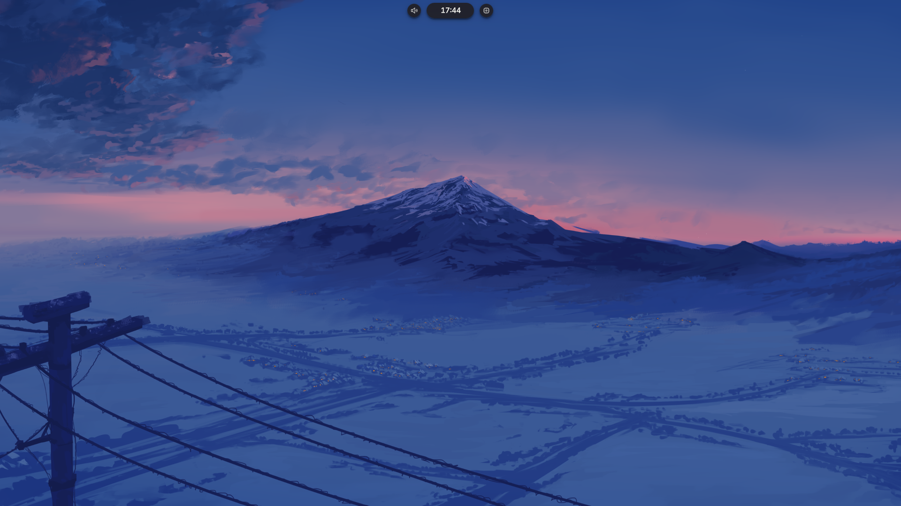
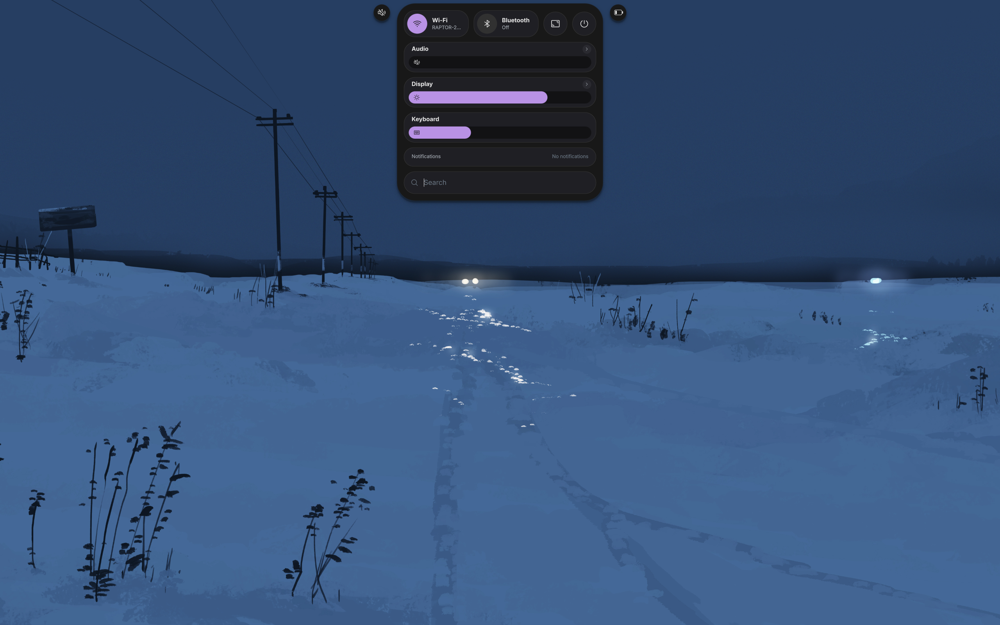
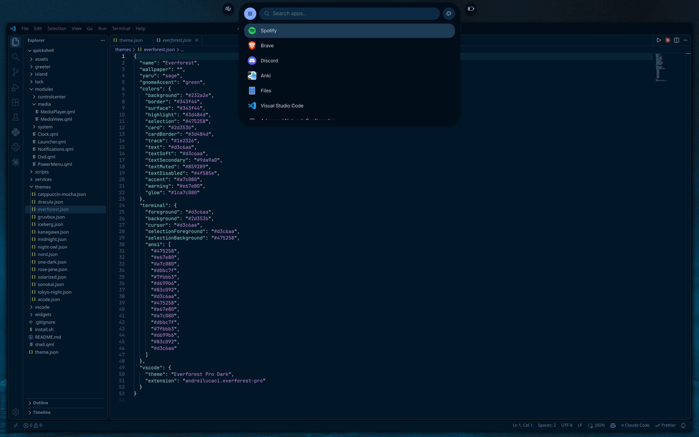
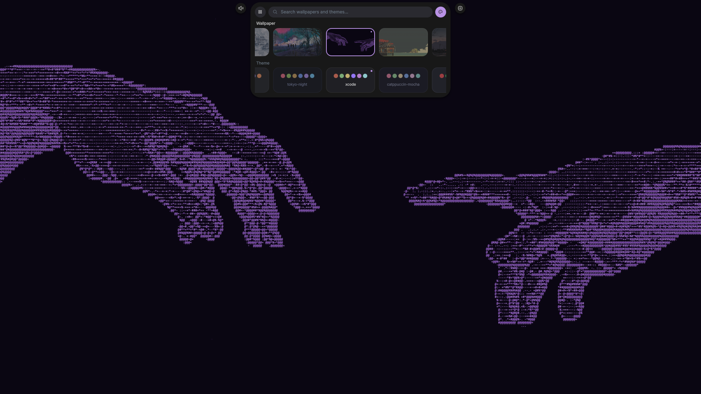
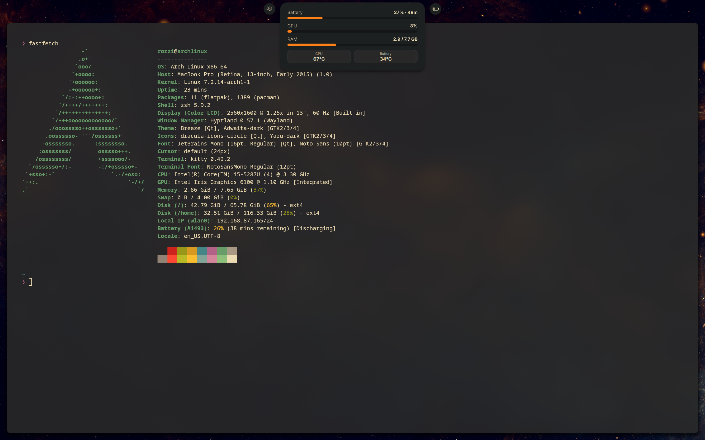

# Quickshell island

A Hyprland shell built on Quickshell (>= 0.3): an island at the top of the
screen with clock, notifications, launcher, media player, control center,
lock screen, login screen and a settings window. Works on **Arch** and
**Fedora**.

## Screenshots

<table>
  <tr>
    <td></td>
    <td></td>
    <td></td>
    <td></td>
    <td></td>
    <td></td>
  </tr>
  <tr>
    <td align="center"><b>Island</b></td>
    <td align="center"><b>Control center</b></td>
    <td align="center"><b>App launcher</b></td>
    <td align="center"><b>Theme and wallpaper switcher</b></td>
    <td align="center"><b>Media player</b></td>
    <td align="center"><b>Performance monitoring</b></td>
  </tr>
</table>

## Installation

```sh
[ -d ~/.config/quickshell ] && mv ~/.config/quickshell ~/.config/quickshell_backup
mkdir -p ~/.config/quickshell
curl -L https://github.com/RozziLando/quickshell/archive/refs/heads/main.tar.gz \
    | tar -xz --strip-components=1 -C ~/.config/quickshell
cd ~/.config/quickshell
./install.sh
```

Run it as your normal user: it asks for the sudo password when needed.

This downloads only the files of the shell (about 1 MB): a plain
configuration folder, not a git repository, without the history and without
the screenshots of this page.

`install.sh` does only five things:

1. detects Arch or Fedora and installs the [dependencies](#dependencies).
   Packages that are already installed are skipped (`pacman --needed` on
   Arch; on Fedora it also enables the Hyprland and Quickshell COPRs). It
   also detects a laptop (battery or built-in screen) or a desktop: a laptop
   gets `brightnessctl` and `upower`, a desktop gets `ddcutil` (brightness of
   the monitors) and the `i2c-dev` module it needs;
2. makes Wi-Fi and Bluetooth work on a fresh install: it installs the
   firmware (`linux-firmware`, on Fedora the per-vendor firmware packages and
   `NetworkManager-wifi`), installs `broadcom-wl-dkms` for the Broadcom cards
   without an open driver (BCM4360, BCM4352, BCM43142; on Fedora it points
   to RPM Fusion), enables NetworkManager (disabling iwd, systemd-networkd or
   dhcpcd, which would conflict with it) and the bluetooth service when a
   Bluetooth adapter is present, and removes software rfkill blocks. When a
   reboot is needed to load drivers or services, it says so;
3. turns on `FastConnectable` in `/etc/bluetooth/main.conf`, so known
   Bluetooth devices reconnect faster when they are switched on (the old
   file is kept as `main.conf.bak-quickshell`; applied at the next boot);
4. creates the wallpaper folder (`wallpaperDir` in `theme.json`, by default
   `~/Wallpapers`) if it is missing. The wallpapers are not part of the
   repository: put your images there (png, jpg, webp);
5. if VS Code, VSCodium or Code - OSS is installed, asks whether to install
   the local extension that makes it follow the shell theme (see
   [VS Code themes](#vs-code-themes)).

Everything else is up to you: put (or link) the folder in
`~/.config/quickshell`, set your options in [`theme.json`](#themejson), add
the [keybinds](#keybinds) you want to the Hyprland config and start the shell
with Hyprland (`exec-once = quickshell`, or `hl.exec_cmd("quickshell")` in a
Lua config).

**Login screen.** `sudo greeter/install.sh` sets it up completely, on Arch
and Fedora: it installs `greetd`, `cage` and `agreety`, copies the login screen to
`/etc/greetd/quickshell`, writes `/etc/greetd/config.toml` (the old one is
kept as `config.toml.bak-<date>`), disables the current display manager
(sddm, gdm, lightdm, ly...) and enables greetd. Reboot and the login screen
is there. `--dry-run` shows what it would do without changing anything; at
the end it prints the command to go back to the previous display manager.
greetd starts `/usr/local/bin/quickshell-greeter`, which waits for the
graphics card, starts the login screen and checks that it really appears:
if it does not (a crash, an error in the configuration) it tries again, and
after three failures it opens `agreety`, the text login of greetd, which
starts Hyprland too. So you can always log in, never a black screen.

**Profile picture.** To show your photo on the lock screen and the login
screen, click the circle at the bottom left of the [settings](#settings)
and pick an image: it is cropped to a square and saved as
`assets/avatar.png`. By hand, put it in `assets/` named `avatar.png`,
`avatar.jpg` or `avatar.jpeg` (a square image looks best). Without it the
circle shows the first letter of your user name. The file is not part of the
download, so set it on each PC.

| Option | Effect |
|---|---|
| `./install.sh -y` | accept the defaults, ask nothing |
| `./install.sh --no-packages` | skip the package installation |
| `./install.sh --laptop` / `--desktop` | force the laptop or desktop packages instead of detecting them |

**Updating.** When a newer version is on GitHub, the settings window shows
an **Update** button next to your picture (and in *System*). It downloads
the new version, replaces the files of the shell, removes the files that an
earlier update installed and the new version no longer has, keeps
`theme.json`, the avatar, the wallpapers and the themes you added, then
restarts the shell. The installed version is in
`VERSION` (filled in by GitHub in the download). A folder that is a git
clone is updated with `git pull --ff-only` instead.

By hand, the same command as the installation with `--exclude` does it too:

```sh
curl -L https://github.com/RozziLando/quickshell/archive/refs/heads/main.tar.gz \
    | tar -xz --strip-components=1 -C ~/.config/quickshell --exclude=quickshell-main/theme.json
```

New options added to `theme.json` by an update use their default value until
you change them.

## Settings

*Quickshell Settings* changes everything in `theme.json` with switches,
sliders and menus, live. Open it from the app launcher (the shell creates
`~/.local/share/applications/quickshell-settings.desktop` by itself) or with
`qs ipc call settings open`. It is a fixed-size floating window, part of the
shell: nothing to install.

- **General**: scale, main monitor (by name, e.g. `OMEN by HP 25`: it stays
  the same on any port), Bluetooth on startup (only with a Bluetooth
  adapter), network monitor, background apps, monitor brightness (only on
  desktops), VS Code theme sync.
- **Appearance**: font (every installed font), icons (every Phosphor weight
  found in `assets/fonts` or installed, or the classic drawn icons), island
  type, minimal, auto hide, glow, dark shadow, glass and its opacity.
- **Login & Lock**: login screen and its blur, lock screen and its blur,
  sleep, lock and sleep after inactivity. The login screen needs
  `sudo greeter/install.sh` after a change: the page says when and copies the
  command.
- **Wallpapers & Themes**: the same wallpaper and theme rows as the launcher.
  The pencil on the selected wallpaper chooses one or more themes for it
  (with suggestions from its colors); the pencil on the selected theme
  chooses one or more wallpapers for it. With more than one, one is picked
  at random each time. **+**
  copies new images into the wallpaper folder. Also the folder and the
  transition.
- **System**: your system like `fastfetch`, with the logo of the
  distribution in the color of the theme and the use of memory, swap and
  disks. The logo is not part of the shell: it is read from the files of the
  distribution (`LOGO` in `/etc/os-release`, from `/usr/share/pixmaps` or the
  icon theme) and recolored live; its white parts become see-through. To use
  another one put it in `assets/logos/<ID>.svg` or `.png` (`<ID>` as in
  `/etc/os-release`).

Every *i* explains its option. Files and folders are picked with the file
chooser of the system (`zenity`, or `kdialog`).

## Dependencies

| Used for | Arch | Fedora |
|---|---|---|
| Shell (>= 0.3) | `quickshell` | `quickshell` (COPR `errornointernet/quickshell`) |
| Compositor | `hyprland` | `hyprland` (COPR `solopasha/hyprland`) |
| Wallpaper | `awww` | `swaybg` |
| Wi-Fi | `networkmanager` `linux-firmware` `wireless-regdb` | `NetworkManager` `NetworkManager-wifi` `wireless-regdb` + firmware packages |
| Bluetooth | `bluez` `bluez-utils` | `bluez` |
| Audio | `pipewire` `pipewire-pulse` `wireplumber` `libpulse` | `pipewire` `pipewire-pulseaudio` `wireplumber` `pulseaudio-utils` |
| Screen brightness, battery (laptop only) | `brightnessctl` `upower` | `brightnessctl` `upower` |
| Monitor brightness (desktop only) | `ddcutil` | `ddcutil` |
| Media keys | `playerctl` | `playerctl` |
| Screenshots, lock screen | `grim` `slurp` `wl-clipboard` | `grim` `slurp` `wl-clipboard` |
| Notifications, logind signals | `libnotify` `glib2` | `libnotify` `glib2` |
| Login screen copy | `diffutils` | `diffutils` |
| .webp wallpapers | `qt6-imageformats` | `qt6-qtimageformats` |
| Fonts | `inter-font` `noto-fonts-emoji` `noto-fonts-cjk` | `rsms-inter-fonts` `google-noto-color-emoji-fonts` `google-noto-sans-cjk-fonts` |
| Login screen (installed by `greeter/install.sh`) | `greetd` `greetd-agreety` `cage` | `greetd` `cage` |
| Settings: file chooser, updates, GPU name | `zenity` `curl` `pciutils` | `zenity` `curl` `pciutils` |

`install.sh` installs all of them. The icon font (Phosphor) ships with the
shell in `assets/fonts/`.

## IPC

`qs ipc call <target> <function>` controls the running shell from a
terminal, a script or a keybind. `qs ipc show` lists everything available.

| Command | What it does |
|---|---|
| `qs ipc call launcher toggle` | open / close the app launcher |
| `qs ipc call controlcenter toggle` | open / close the control center |
| `qs ipc call power toggle` | open / close the power menu |
| `qs ipc call screenshot region` | screenshot of an area selected with the mouse, to the clipboard |
| `qs ipc call screenshot screen` | screenshot of the screen under the mouse, to the clipboard |
| `qs ipc call screenshot save` | screenshot of the screen under the mouse, to the clipboard and saved in `~/Pictures` |
| `qs ipc call media peek` | show the media player for a few seconds |
| `qs ipc call theme list` | list the themes |
| `qs ipc call theme current` | print the active theme |
| `qs ipc call theme set <id>` | apply a theme (shell, kitty, Nautilus, wallpaper), e.g. `theme set nord` |
| `qs ipc call lock lock` | lock the screen (with `"lockScreen": true`) |
| `qs ipc call lock suspend` | lock and suspend |
| `qs ipc call settings open` | open the settings window (or bring it to the front) |
| `qs ipc call settings page <name>` | open it on a page: `general`, `appearance`, `lock`, `wallpapers`, `system` |
| `qs ipc call settings toggle` / `close` | open / close it |

## Keybinds

Suggested binds for the Hyprland config (add them yourself):

| Keys | Command |
|---|---|
| `ALT + SPACE` | `qs ipc call launcher toggle` |
| `SUPER + C` | `qs ipc call controlcenter toggle` |
| `SUPER + ESCAPE` | `qs ipc call power toggle` |
| `SUPER + S` | `qs ipc call screenshot region` |
| `SUPER + A` | `qs ipc call screenshot save` |
| `SUPER + Q` | `pkill -x quickshell \|\| quickshell` (restart the shell) |
| Play / Pause / Next / Previous | `playerctl …; qs ipc call media peek` |
| Volume up / down / mute, mic mute | `wpctl …` (the island shows the volume bar by itself) |
| Screen brightness (laptops) | `brightnessctl …` (the island shows the bar by itself) |
| Keyboard backlight (if present) | `brightnessctl -d <device> …` |

Other useful commands:

| Command | What it does |
|---|---|
| `qs` / `quickshell -d` | start the shell (`-d`: detached from the terminal) |
| `pkill -x quickshell` | stop the shell |
| `qs log` | log of the running shell (`qs log -f` follows it) |
| `qs list` | running instances (there should be one) |

Saved `.qml` files and `theme.json` are reloaded automatically: there is no
need to restart the shell.

## VS Code themes

Optional: when the shell theme changes, VS Code switches to the matching
color theme, live. Everything is in one local extension,
`vscode/quickshell-theme-sync`, with nothing to download: `install.sh` asks
for it, and `scripts/vscode.sh` installs or updates it later.

- `themes/`: the VS Code theme of every shell theme, as written files.
  Catppuccin Mocha, Dracula, Everforest, Gruvbox, Iceberg, Kanagawa, Night
  Owl, Nord, One Dark, Rosé Pine, Solarized, Sonokai and Tokyo Night are
  exact copies of their official VS Code themes (licenses and versions in
  `THIRD_PARTY_NOTICES.md`); Midnight, Cloudy Quasar and Xcode are made for
  the shell. In VS Code they are called `<name> (Quickshell)`, e.g.
  `Dracula (Quickshell)`.
- `Quickshell Custom`: for a shell theme without a file in `themes/` (a
  theme you made) or whose file cannot be read, the extension generates a
  theme from the shell colors and applies it. The command
  *Quickshell: Generate Theme From Shell Colors* does the same for the
  current theme on request. When a generated theme replaces another
  generated one, VS Code asks to reload the window.

The extension acts only when the shell theme changes, so a theme picked by
hand in VS Code stays until the next one. `"vscodeThemeSync": false` in
`theme.json` turns it off. The shell never depends on the editor.

It works the same in every editor built on VS Code.

**Installing by hand.** The ready package is
`vscode/quickshell-theme-sync/local.quickshell-theme-sync-<version>.vsix`,
rebuilt by every run of the script (`scripts/vscode.sh --pack` only
rebuilds it). Install it with `code --install-extension <file>.vsix`, or in
VS Code: Extensions view → `…` menu → *Install from VSIX…*, then reload the
window.

**A new shell theme** needs nothing: `Quickshell Custom` covers it. To ship
a written theme for it, put the VS Code theme in
`vscode/quickshell-theme-sync/themes/<id>.json` (`<id>` as in `themes/`),
add it to `contributes.themes` in that extension's `package.json` with the
label `<name> (Quickshell)`, raise `version` and run `scripts/vscode.sh`.

## theme.json

All the settings live in `theme.json`, in this folder. Changes apply as soon
as the file is saved. The [settings window](#settings) edits the same file.

| Option | Values | Meaning |
|---|---|---|
| `scale` | number (0.5–3) | size of the whole shell |
| `monitor` | `""`, a model like `"OMEN by HP 25"` or a port like `"HDMI-A-1"`, `"DP-1"`, `"eDP-1"` | screen of the island, the lock screen and the login screen (`hyprctl monitors`: `model` or `name`). Empty or not connected: the laptop screen, otherwise the first one |
| `fontFamily` | font name | shell font |
| `iconFont` | `phosphor`, `phosphor-light`, `phosphor-bold`, `phosphor-fill`, `classic` (or `phosphor-<weight>` for another Phosphor weight in `assets/fonts` or installed) | icon style |
| `islandStyle` | `"floating"` / `"attached"` | detached island with side circles, or attached to the top edge |
| `minimal` | `true` / `false` | only the clock at rest, icons appear on hover |
| `autoHide` | `true` / `false` | hide the island when windows are open (hover the top edge to bring it back) |
| `glowEnabled` | `true` / `false` | glow in the theme color around island and windows |
| `darkShadow` | `true` / `false` | classic dark shadow instead of the glow |
| `glass` | `true` / `false` | translucent island and windows with blurred background |
| `glassOpacity` | 0.3–1 | opacity with `glass` |
| `lockBlur` | `true` / `false` | lock screen: blurred screen contents, or the plain wallpaper |
| `loginBlur` | `true` / `false` | login screen: blurred or plain wallpaper |
| `lockScreen` | `true` / `false` | lock screen (shortcut, inactivity, before sleep) |
| `loginScreen` | `true` / `false` | `false`: automatic login into Hyprland (run `sudo greeter/install.sh` again after changing it) |
| `sleepEnabled` | `true` / `false` | sleep from the power menu and after inactivity |
| `idleLockMinutes` | minutes, `0` = never | lock after this much inactivity |
| `idleSleepMinutes` | minutes, `0` = never | sleep after this much inactivity |
| `bluetoothOnStartup` | `true` / `false` | Bluetooth on or off at the first shell start after boot |
| `theme` | theme id | `catppuccin-mocha`, `cloudy-quasar`, `dracula`, `everforest`, `gruvbox`, `iceberg`, `kanagawa`, `midnight`, `night-owl`, `nord`, `one-dark`, `rose-pine`, `solarized`, `sonokai`, `tokyo-night`, `xcode` (files in `themes/`) |
| `wallpaperDir` | folder | wallpapers shown in the launcher (`Tab` switches to themes and wallpapers) |
| `wallpaperTransition` | `grow`, `outer`, `wave`, `wipe`, `fade`, `simple`, `left`, `right`, `top`, `bottom`, `center`, `any`, `random`, `none` | wallpaper change animation (awww) |
| `vscodeThemeSync` | `true` / `false` | VS Code follows the shell theme (needs the [VS Code extension](#vs-code-themes)); `false`: VS Code keeps its own theme |
| `networkMonitor` | `true` / `false` | system monitor (right click on the island): also shows the network speed, download and upload of all the network cards |
| `backgroundApps` | `true` / `false` | system monitor: the "Background apps" list under the temperatures (apps with open windows; the × closes all the processes of that app). A click on an app takes you to its most recent window |
| `displayOnDesktop` | `true` / `false` | desktop PC: show the Display slider and page in the control center too. The slider sets the brightness of the monitors through DDC/CI (`ddcutil`, all monitors together; DDC/CI must be on in the monitor menu). Laptops always have them |
| `wallpaperThemes` | `{ "wallpaper.png": ["theme-id", ...] }` | the themes that go with a wallpaper: picking it applies one of them, at random if more (the pencil on a wallpaper in the settings). Missing: automatic, by colors |
| `themeWallpapers` | `{ "theme-id": ["wallpaper.png", ...] }` | the wallpapers that go with a theme: applying it sets one of them, at random if more (the pencil on a theme in the settings). Missing: the theme's own `defaultWallpapers` |

## Wallpapers and themes

The wallpapers are the images in `wallpaperDir` (by default `~/Wallpapers`);
the launcher lists them (`Tab` switches to themes and wallpapers). At the
first start, when no wallpaper was ever set, the shell applies the default
wallpaper of the current theme or the first image of the folder; after that
it keeps the last one picked, also when the wallpaper daemon loses it.

When you pick a wallpaper in the launcher, the shell also applies the theme
that matches its colors. To choose the theme yourself for some wallpapers,
list them in `preferredBy` in `themes/<id>.json`:

```json
"preferredBy": ["a.png", "b.png"]
```

- a wallpaper listed in a theme always gets that theme, without the color
  match;
- a wallpaper listed in more than one theme gets one of them at random;
- `[]` (empty): automatic choice by colors, as before;
- names are the file names in `wallpaperDir` (`"a"` without the
  extension works too).

`"defaultWallpapers"` is something else: the wallpapers set when that theme
is applied (one at random if there are more, `[]` = keep the current one).

The pencils in the [settings](#settings) do the same for you, without
touching the theme files: they write `wallpaperThemes` and `themeWallpapers`
in `theme.json`, which come before `preferredBy` and `defaultWallpapers`.
