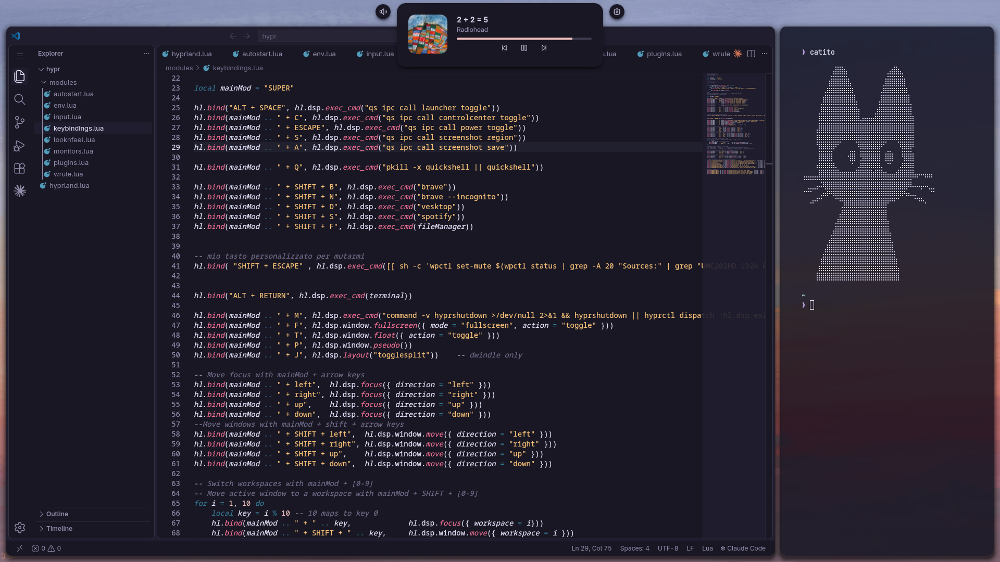

# Quickshell

A Hyprland shell built on Quickshell (>= 0.3): an island at the top of the
screen, or a bar on any edge, with clock, notifications, launcher, media
player, control center, lock screen, login screen and a settings window.
Works on **Arch**, **Debian**, **Ubuntu**, **Fedora**, **RHEL** and their
derivatives.

## Screenshots

<table>
  <tr>
    <td></td>
    <td></td>
    <td></td>
    <td></td>
    <td></td>
    <td></td>
  </tr>
  <tr>
    <td align="center"><b>Island</b></td>
    <td align="center"><b>Control center</b></td>
    <td align="center"><b>App launcher</b></td>
    <td align="center"><b>Theme and wallpaper switcher</b></td>
    <td align="center"><b>Media player</b></td>
    <td align="center"><b>Performance monitoring</b></td>
  </tr>
</table>

## Installation

```sh
[ -d ~/.config/quickshell ] && mv ~/.config/quickshell ~/.config/quickshell_backup
mkdir -p ~/.config/quickshell
curl -L https://github.com/RozziLando/quickshell/archive/refs/heads/main.tar.gz \
    | tar -xz --strip-components=1 -C ~/.config/quickshell
cd ~/.config/quickshell
./install.sh
```

Run it as your normal user (it asks for sudo when needed). `install.sh`
installs the [dependencies](#dependencies) (laptop or desktop packages are
detected), makes Wi-Fi and Bluetooth work, creates the wallpaper folder
(`~/Wallpapers`) and offers the login screen and the [VS Code
extension](#vs-code-themes). Options: `-y` (ask nothing), `--no-packages`,
`--laptop` / `--desktop`.

Then start the shell with Hyprland (`exec-once = quickshell`, or
`hl.exec_cmd("quickshell")` in a Lua config) and add the
[keybinds](#ipc-and-keybinds) you want.

- **Login screen**: `sudo greeter/install.sh` sets up greetd with the
  Quickshell login screen (`--dry-run` to preview). If it ever fails to
  start, it falls back to a text login, so you can always log in.
- **Profile picture**: click the circle at the bottom left of the settings,
  or put `assets/avatar.png` (or `.jpg`) by hand.
- **Updating**: the settings window shows an **Update** button when a new
  version is on GitHub. It keeps `theme.json`, the avatar, the wallpapers
  and your themes, then restarts the shell. A git clone is updated with
  `git pull`.

## Settings

Everything is set in *Quickshell Settings*, live: open it from the app
launcher or with `qs ipc call settings open`. Every option has an *i* that
explains it. The pages are General, Appearance (layout, bar or island style,
bar items, radius, font, icons, effects), Control Center, Login & Lock,
Wallpapers & Themes, and System (system info and updates).

## Dependencies

`scripts/deps.sh` installs only what is missing, at install and at every
update (in a terminal). It never removes or replaces packages.

| Family | Minimum | Quickshell and Hyprland from |
|---|---|---|
| Arch and derivatives | | official repositories |
| Ubuntu and derivatives | 25.10 | `universe`, PPA `avengemedia/danklinux` |
| Debian, Kali | 13 | `trixie-backports` or the archive |
| Fedora and derivatives | 42 | repositories or COPRs `errornointernet/quickshell`, `sdegler/hyprland` |
| RHEL, Rocky, Alma, CentOS Stream | 10 | EPEL, COPRs `errornointernet/quickshell`, `perutzit/hyprland-el` |

Image-based systems (Silverblue, Bazzite) are not supported.

| Used for | Arch | Debian / Ubuntu | Fedora / RHEL |
|---|---|---|---|
| Shell, compositor | `quickshell` `hyprland` | `quickshell` `hyprland` + `qml6-module-qtquick-*` | `quickshell` `hyprland` |
| Wallpaper | `awww` | `awww`, `swww` or `swaybg` | `swww` or `swaybg` |
| Wi-Fi | `networkmanager` `linux-firmware` `wireless-regdb` | `network-manager` `wireless-regdb` | `NetworkManager` `NetworkManager-wifi` + firmware |
| Bluetooth | `bluez` `bluez-utils` | `bluez` | `bluez` |
| Audio | `pipewire` `pipewire-pulse` `wireplumber` `libpulse` | `pipewire` `pipewire-pulse` `wireplumber` `pulseaudio-utils` | `pipewire` `pipewire-pulseaudio` `wireplumber` `pulseaudio-utils` |
| Power mode (laptop) | `power-profiles-daemon` | `power-profiles-daemon` | `tuned-ppd` |
| Brightness, battery | `brightnessctl` (laptop) or `ddcutil` (desktop), `upower` | same | same |
| Screenshots, media keys | `grim` `slurp` `wl-clipboard` `playerctl` | same | same |
| Notifications, logind | `libnotify` `glib2` | `libnotify-bin` `libglib2.0-bin` | `libnotify` `glib2` |
| Images | `qt6-imageformats` `qt6-svg` | `qt6-image-formats-plugins` `qt6-svg-plugins` | `qt6-qtimageformats` `qt6-qtsvg` |
| Fonts | `inter-font` `noto-fonts-emoji` `noto-fonts-cjk` | `fonts-inter` `fonts-noto-color-emoji` `fonts-noto-cjk` | `rsms-inter-fonts` `google-noto-color-emoji-fonts` `google-noto-sans-cjk-fonts` |
| Settings, updates | `zenity` `curl` `pciutils` `git` `diffutils` `xdg-user-dirs` | same | same |
| Login screen (`greeter/install.sh`) | `greetd` `greetd-agreety` `cage` | `greetd` `cage` | `greetd` `cage` |

If PulseAudio, TLP, auto-cpufreq or tuned are installed, the matching
package is skipped. The icon font (Phosphor) ships with the repository.

## IPC and keybinds

`qs ipc call <target> <function>` controls the running shell (`qs ipc show`
lists everything). Suggested binds:

| Keys | Command |
|---|---|
| `ALT + SPACE` | `qs ipc call launcher toggle` |
| `SUPER + C` | `qs ipc call controlcenter toggle` |
| `SUPER + ESCAPE` | `qs ipc call power toggle` |
| `SUPER + S` | `qs ipc call screenshot region` (area to clipboard; `screen` for the whole screen) |
| `SUPER + A` | `qs ipc call screenshot save` (also saved in `~/Pictures`) |
| `SUPER + COMMA` | `qs ipc call settings open` (`settings page <name>` for a page) |
| Media keys | `playerctl …; qs ipc call media peek` |
| Volume / brightness keys | `wpctl …` / `brightnessctl …` (the shell shows the bar by itself) |

Also: `qs ipc call theme set <id>` / `list` / `current`, `qs ipc call lock
lock` / `suspend`. Example in a Lua config and in `hyprland.conf`:

```lua
hl.bind(mainMod .. " + COMMA", hl.dsp.exec_cmd("qs ipc call settings open"))
```

```ini
bind = SUPER, COMMA, exec, qs ipc call settings open
```

`qs log` shows the log of the shell, `pkill -x quickshell` stops it. Saved
`.qml` files and `theme.json` reload automatically. At start the shell
relaunches itself once with a leaner memory setup (`MALLOC_CONF`); start it
with `QS_NO_RESPAWN=1` to skip that.

## Wallpapers and themes

Wallpapers are the images in `wallpaperDir`; the launcher lists them
(`Tab` switches to themes and wallpapers). Picking a wallpaper also applies
the theme that matches its colors. A theme colors the shell, kitty, GTK apps
and, with the extension, VS Code. In the settings, the pencil on a wallpaper
or a theme pairs them by hand. In a theme file, `preferredBy` lists the
wallpapers that always get that theme, and `defaultWallpapers` lists those
set when it is applied.

## VS Code themes

The local extension `vscode/quickshell-theme-sync` switches VS Code (and its
forks) to the matching theme when the shell theme changes. `install.sh`
offers it, and `scripts/vscode.sh` installs or updates it. Themes without a
written file get a theme generated from the shell colors.
`"vscodeThemeSync": false` turns it off.

## theme.json

All the settings live in `theme.json`, which the settings window edits and
the shell reloads on save. It is not in the repository: the shell creates it
at the first start from `theme.default.json` (plus `theme.laptop.json` on
laptops), updates never touch it, and deleting it restores the defaults.

| Option | Values |
|---|---|
| `layout` | `"bar"` (default), `"island"` |
| `barStyle` | `"floating"`, `"attached"`, `"integrated"`, `"transparent"`, `"pills"`, `"pillsAttached"` |
| `barPosition` | `"top"`, `"bottom"`, `"left"`, `"right"` |
| `barItems` | `{ "start": [], "center": [], "end": [] }` with `clock`, `workspaces`, `logo`, `search`, `themes`, `power`, `audio`, `network`, `bluetooth`, `display`, `sysmon`, `notifications`; `split1`, `split2`… start a new pill |
| `barFused`, `barCurves`, `barFrame` | `true` / `false` |
| `barLength` | 20–100 (% of the edge) |
| `edgeGap`, `cornerRadius` | 0–30 |
| `hyprGaps`, `hyprRounding` | `true` / `false`: keep Hyprland gaps and rounding in sync |
| `islandStyle` | `"floating"`, `"attached"` |
| `minimal`, `autoHide`, `audioPanel` | `true` / `false` |
| `toastPosition`, `mediaPosition`, `osdPosition` | `"top-left"`, `"top"`, `"top-right"`, `"bottom-left"`, `"bottom"`, `"bottom-right"` (media and volume/brightness use their own only with `toastSeparate`) |
| `toastSeparate` | `true` / `false` |
| `popupAnimation` | `"pop"`, `"slide"`, `"zoom"`, `"unfold"`, `"fade"`, `"none"`: how cards not fused to the bar appear |
| `popupSpeed` | `"relaxed"`, `"normal"`, `"snappy"` |
| `clockWeekday`, `clockDay`, `clockMonth`, `showEmptyWorkspaces` | `true` / `false` |
| `controlCenter` | `true` / `false` |
| `controlGrid` | `"auto"` or `[{ "id": "clock", "row": 0, "col": 0 }, …]` (6×6 grid) |
| `controlBottom` | `"auto"` or an order of `notifications`, `search`, `apps` |
| `controlWidths` | `{ "audio": 3, "clock": 2 }`: sliders 3–6, clock 2–6 |
| `scale` | 0.5–3 |
| `monitor` | `""` (auto), a model (`"OMEN by HP 25"`) or a port (`"HDMI-A-1"`) |
| `fontFamily` | font name (default `"Inter"`) |
| `iconFont` | `phosphor`, `phosphor-light`, `phosphor-bold`, `phosphor-fill`, `classic` |
| `glowEnabled`, `darkShadow`, `glass` | `true` / `false` |
| `glassOpacity` | 0.3–1 |
| `theme` | id of a file in `themes/` |
| `wallpaperDir` | folder |
| `wallpaperTransition` | `grow`, `outer`, `wave`, `wipe`, `fade`, `simple`, `none`, … |
| `wallpaperThemes`, `themeWallpapers` | `{ "wallpaper.png": ["theme-id"] }`, `{ "theme-id": ["wallpaper.png"] }` |
| `lockScreen`, `lockBlur`, `loginScreen`, `loginBlur`, `sleepEnabled` | `true` / `false` (`loginScreen`: run `sudo greeter/install.sh` again after a change) |
| `idleLockMinutes`, `idleSleepMinutes` | minutes, `0` = never |
| `bluetoothOnStartup`, `networkMonitor`, `backgroundApps`, `powerMode`, `displayOnDesktop`, `vscodeThemeSync`, `updates` | `true` / `false` |
